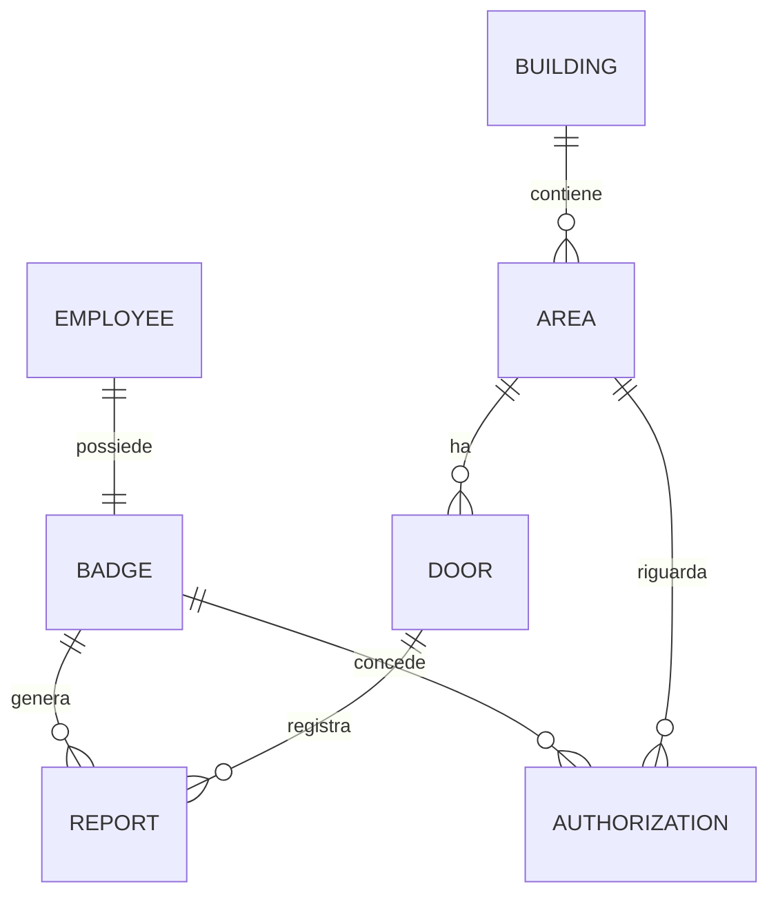

# Modello dati — Access Control Platform

| | |
|---|---|
| **Cliente** | Aurea Precision Components S.p.A. |
| **Team** | LeCucciole — Dario D'Alessandro, Nicolò Florean, Gianmarco Tonelli |
| **Data** | 14/10/2026 |
| **Versione** | v2 (lezione 3) |

Questo documento descrive il modello **in modo agnostico rispetto al
database**: entità, attributi (con tipo logico), relazioni e vincoli. Lo schema
fisico concreto del progetto è in [`../schema.sql`](../schema.sql); qui lo si
riporta come *esempio* per mostrare come il modello è stato realizzato.

## 1. Entità

| Entità | Descrizione | Attributi essenziali (tipo logico) |
|---|---|---|
| Dipendente | persona dell'azienda titolare di un badge | `id` (identificativo), `nome` (testo), `email` (testo), `attivo` (booleano) |
| Badge | identificativo virtuale usato per richiedere l'accesso a un varco | `id`, `codice` (testo), `dipendente` (riferimento), `attivo` (booleano) |
| Edificio | immobile della sede | `id`, `nome` (testo), `indirizzo` (testo) |
| Area | porzione di edificio su cui si applicano le autorizzazioni | `id`, `edificio` (riferimento), `nome` (testo) |
| Varco | punto di accesso fisico a un'area (porta, tornello) | `id`, `area` (riferimento), `codice` (testo) |
| Autorizzazione | associazione tra un badge e un'area che ne consente l'accesso | `id`, `badge` (riferimento), `area` (riferimento), `valido_dal` (data/ora), `valido_al` (data/ora), `revocata_il` (data/ora) |
| Segnalazione | tentativo di accesso di un badge a un varco, con esito | `id`, `badge` (riferimento), `varco` (riferimento), `richiesto_il` (data/ora), `esito` (enumerazione), `motivazione` (testo) |

`esito` ammette i valori `ACCESS_GRANTED` e `ACCESS_DENIED`.

## 2. Relazioni

| Relazione | Cardinalità |
|---|---|
| Dipendente → Badge | uno-a-uno (un dipendente ha esattamente un badge) |
| Edificio → Area | uno-a-molti (un edificio contiene più aree) |
| Area → Varco | uno-a-molti (un'area ha più varchi; un varco appartiene a una sola area) |
| Badge ↔ Area (tramite Autorizzazione) | molti-a-molti (un badge può essere autorizzato su più aree) |
| Badge → Segnalazione | uno-a-molti (un badge genera più tentativi) |
| Varco → Segnalazione | uno-a-molti (un varco registra più tentativi) |

Punto chiave del dominio: un badge **non** è autorizzato direttamente su un
varco, ma su un'**area**; è il varco a determinare su quale area si sta
chiedendo accesso.



## 3. Vincoli

Vincoli che il database fa rispettare da solo, indipendentemente dal codice:

- ogni entità ha una chiave primaria `id` autoincrementale;
- `employees.email` è univoca e obbligatoria;
- `badges.code` è univoco e obbligatorio; `badges.employee_id` è **univoco** (un
  dipendente ha esattamente un badge) e obbligatorio;
- `doors.code` è univoco e obbligatorio;
- `areas.building_id`, `doors.area_id`, `authorizations.badge_id`,
  `authorizations.area_id` sono chiavi esterne obbligatorie: non si può
  riferire un'entità inesistente;
- la coppia `(badge_id, area_id)` in `authorizations` è univoca;
- `employees.active` e `badges.active` ammettono solo `0`/`1`;
- `reports.result` ammette solo `ACCESS_GRANTED` o `ACCESS_DENIED`;
- `reports.requested_at` e `reports.reason` sono obbligatori.

## 4. Rappresentazione dello schema

Lo schema fisico è mantenuto nel file [`../schema.sql`](../schema.sql), separato
dal codice applicativo. Frammento **di esempio** (SQLite, non vincolante):

```sql
CREATE TABLE employees (
  id     INTEGER PRIMARY KEY AUTOINCREMENT,
  name   TEXT NOT NULL,
  email  TEXT NOT NULL UNIQUE,
  active INTEGER NOT NULL DEFAULT 1 CHECK (active IN (0, 1))
);

CREATE TABLE badges (
  id          INTEGER PRIMARY KEY AUTOINCREMENT,
  code        TEXT NOT NULL UNIQUE,
  employee_id INTEGER NOT NULL UNIQUE REFERENCES employees(id),
  active      INTEGER NOT NULL DEFAULT 1 CHECK (active IN (0, 1))
);

CREATE TABLE areas (
  id          INTEGER PRIMARY KEY AUTOINCREMENT,
  building_id INTEGER NOT NULL REFERENCES buildings(id),
  name        TEXT NOT NULL
);

CREATE TABLE authorizations (
  id         INTEGER PRIMARY KEY AUTOINCREMENT,
  badge_id   INTEGER NOT NULL REFERENCES badges(id),
  area_id    INTEGER NOT NULL REFERENCES areas(id),
  valid_from TEXT,
  valid_to   TEXT,
  revoked_at TEXT,
  UNIQUE (badge_id, area_id)
);

CREATE TABLE reports (
  id           INTEGER PRIMARY KEY AUTOINCREMENT,
  badge_id     INTEGER REFERENCES badges(id),
  door_id      INTEGER REFERENCES doors(id),
  requested_at TEXT NOT NULL DEFAULT CURRENT_TIMESTAMP,
  result       TEXT NOT NULL CHECK (result IN ('ACCESS_GRANTED', 'ACCESS_DENIED')),
  reason       TEXT NOT NULL
);
```

## 5. Modello applicativo e livelli

Lo stesso dato assume tre forme distinte, che il codice tiene separate
(vedi `src/`):

- **riga di tabella** — come è conservata nel database (snake_case);
- **oggetto di dominio / DTO** — come l'API la espone a chi chiama.

Il backend è organizzato a livelli, ognuno responsabile di una cosa sola:

| Livello | Responsabilità | File |
|---|---|---|
| Controller | riceve la richiesta, valida il formato, formatta la risposta | `src/controllers/reports.controller.ts` |
| Servizio | regole del cliente e casi d'uso | `src/services/reports.service.ts` |
| Repository | accesso ai dati, SQL | `src/repositories/reports.repository.ts` |
| Database | righe e vincoli | `schema.sql` |

Il controller non conosce l'SQL; il repository non conosce le regole.

## 6. Evoluzioni

| Data | Cosa è cambiato | Perché |
|---|---|---|
| 30/09/2026 | Prima bozza: entità e relazioni del dominio accessi | lezione 1 |
| 07/10/2026 | Schema fisico in `schema.sql`, collegamento del backend a SQLite | lezione 3 |
| 14/10/2026 | Separazione del backend in Controller / Servizio / Repository | lezione 3 (persistenza e livelli) |
